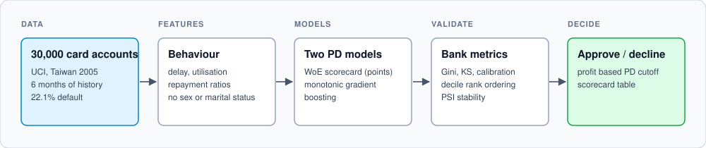
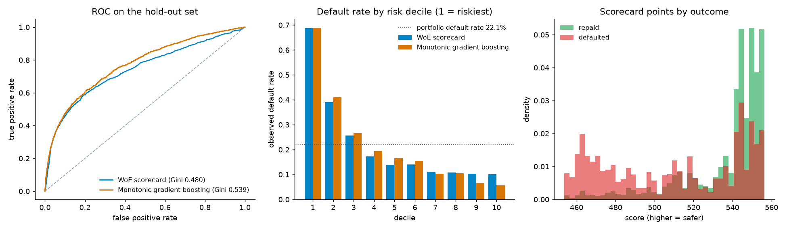
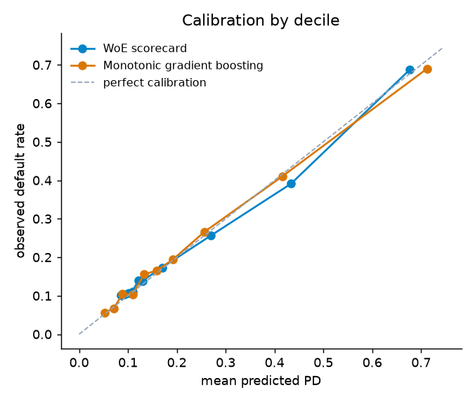

# credit-risk-scorecard

**Probability of default (PD) model for credit card clients, built the way a bank's risk team would build and validate it:** a weight of evidence (WoE) scorecard with points, a monotonic gradient boosting challenger, validation with Gini, KS, calibration and PSI, and a profit based approval cutoff.

[](https://github.com/DanielYamanoglu/credit-risk-scorecard/actions/workflows/ci.yml)




> **Public data.** UCI *Default of Credit Card Clients*: 30,000 card accounts from a Taiwanese bank in 2005, six months of repayment history, 22.1% defaulted the following month. `credit-risk download` fetches it; it is not stored in this repository.

## Results

70/30 stratified split. Both models are cross-validated (5 folds) on the 21,000 training accounts; the 9,000 hold-out accounts are scored once.

| Model | CV Gini | Test Gini | Test AUC | KS | Brier | Calibration error | PSI train vs test |
|---|---|---|---|---|---|---|---|
| WoE scorecard (6 characteristics) | 0.515 ± 0.020 | 0.480 | 0.740 | 0.393 | 0.140 | 0.013 | 0.001 |
| Monotonic gradient boosting | 0.557 ± 0.018 | **0.539** | **0.770** | **0.408** | **0.137** | **0.010** | 0.000 |



**Rank ordering.** Default rate by predicted risk decile on the hold-out, riskiest first:

| Decile | 1 | 2 | 3 | 4 | 5 | 6 | 7 | 8 | 9 | 10 |
|---|---|---|---|---|---|---|---|---|---|---|
| Scorecard | 68.8% | 39.1% | 25.7% | 17.3% | 13.9% | 14.0% | 11.1% | 10.8% | 10.3% | 10.2% |
| Gradient boosting | 69.0% | 41.0% | 26.6% | 19.4% | 16.6% | 15.6% | 10.3% | 10.4% | 6.7% | 5.7% |

**Approval cutoff.** Assuming a repaying account earns 1 unit and a defaulting one loses 5, approving everyone loses 327 units per 1,000 applicants. The profit maximising PD cutoff of the gradient boosting model approves 55% of applicants, halves the default rate among them (10.0% vs 22.1%) and earns 221 units per 1,000 applicants. The scorecard's cutoff approves 61% at an 11.7% default rate and earns 180.

What the numbers say:

- **The challenger wins on discrimination, the scorecard wins on transparency.** Gradient boosting adds 6 Gini points and separates the safest deciles better (5.7% vs 10.2% default in decile 10). The scorecard can be printed on one page and every point traced to a characteristic, which is what model validation and regulators usually ask for first.
- **Both are well calibrated** (predicted and observed default rates within about one point per decile) and **stable** between training and hold-out (PSI near zero), as expected from a random split.
- **Repayment behaviour carries almost all of the signal.** The three delay characteristics have information values of 0.78 to 0.88; age and education fall below the 0.02 threshold and are dropped by the scorecard.



## The scorecard

600 points at good:bad odds of 50:1, odds double every 20 points. An applicant's score is the sum of the points for their attribute in each characteristic. Excerpt for the most recent month's repayment status (full table in [`reports/scorecard.csv`](reports/scorecard.csv)):

| Current repayment status | Accounts (train) | Default rate | Points |
|---|---|---|---|
| No balance used | 1,933 | 12.6% | 98.7 |
| Paid in full or revolving | 14,256 | 13.8% | 96.9 |
| 1 month late | 2,616 | 34.2% | 76.9 |
| 2+ months late | 2,195 | 69.8% | 51.6 |

## How it works

- **Features** ([`features.py`](src/credit_risk/features.py)): current and maximum delay, number of late months, utilisation (balance over limit), repayment ratio (payment over the previous statement), balance trend, limit, age and education. **Sex and marital status are excluded** as protected characteristics.
- **WoE binning** ([`woe.py`](src/credit_risk/woe.py)): up to 10 quantile bins, merged until every bin holds at least 5% of accounts and WoE moves in one direction, so the points never reward more delay or more utilisation. Characteristics with information value below 0.02 are dropped.
- **Scorecard** ([`scorecard.py`](src/credit_risk/scorecard.py)): logistic regression on WoE. Characteristics whose coefficient comes out with the wrong sign because of collinearity are removed, so every point moves the way its WoE says. Repayment ratios and current utilisation were dropped this way: they carry the same information as the delay characteristics.
- **Challenger** ([`train.py`](src/credit_risk/train.py)): histogram gradient boosting with monotone constraints (more delay or utilisation never lowers PD; more limit or repayment never raises it), so the model stays explainable to a credit committee.
- **Validation** ([`metrics.py`](src/credit_risk/metrics.py)): Gini, KS, Brier score, decile calibration, rank ordering and PSI, the standard set for retail PD models.

## Quickstart

Requires [uv](https://docs.astral.sh/uv/) and Python 3.12.

```bash
uv sync
uv run credit-risk download
uv run pytest
uv run credit-risk train      # writes reports/metrics.json, reports/scorecard.csv and figures (about 15 s)
```

## Project structure

```
src/credit_risk/data.py       download, load, stratified split
src/credit_risk/features.py   behavioural features, protected characteristics excluded
src/credit_risk/woe.py        monotonic WoE binning and information value
src/credit_risk/scorecard.py  logistic regression on WoE, points scaling, scorecard table
src/credit_risk/train.py      cross-validation, challenger model, hold-out scoring, profit cutoff
src/credit_risk/metrics.py    Gini, KS, calibration, deciles, PSI, cutoff search
src/credit_risk/figures.py    validation figures
tests/                        8 tests: WoE and IV by hand, monotonic bins, points add up to the score,
                              score to odds scaling, monotone constraints, KS/Gini/PSI, cutoff by hand
```

## Limitations

- **No out-of-time validation.** The dataset covers a single observation month, so the hold-out is a random split, not a later period. PSI near zero says nothing about drift over time here.
- **Old, foreign data.** Taiwan in 2005 had a card debt crisis; default rates and behaviour differ from a Turkish portfolio today.
- **The profit cutoff rests on an assumed 1:5 gain to loss ratio**, not on real margins, exposure or loss given default.
- Behavioural (existing customer) model only: there is no application data such as income or bureau scores.

## What I'd do next

- Out-of-time validation on a dataset with a time dimension, and a monitoring report (PSI, characteristic analysis) per month.
- Expected loss: combine PD with exposure at default and loss given default.
- Reject inference and a fairness review across age groups before any real use.
- Probability calibration to a long-run central tendency, as IRB models require.

## License

MIT. See [LICENSE](LICENSE). Data: Yeh, I. C. (2009), *Default of Credit Card Clients*, UCI Machine Learning Repository, CC BY 4.0.
